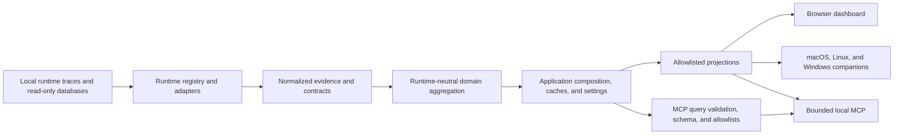

# Token Meter Architecture

This is the canonical current engineering map for Token Meter. For product use,
start with the [README](../README.md). Coding agents must also read
[AGENTS.md](AGENTS.md) explicitly because agent instruction files do not live at
the repository root.

## System at a Glance

Token Meter is a local, dependency-free Python service with a browser dashboard
and native companions. It discovers evidence created by supported coding-agent
runtimes, converts runtime-specific records into common usage concepts, and
exposes only bounded projections to each client.

The server binds to `127.0.0.1:8722`. `meter.py` is intentionally only an
executable and import-compatibility facade; current composition lives in
`token_meter/app.py`.

## Responsibility Boundaries

| Area | Owner | Responsibility |
| --- | --- | --- |
| Runtime identity and discovery | `token_meter/runtimes/` | Find sources, compute revisions, read inputs safely, parse runtime formats, and return normalized evidence. |
| Shared evidence contracts | `token_meter/contracts.py`, `token_meter/compat.py` | Keep runtime, model provider, account provider, source locator, availability, and provenance distinct; preserve bounded compatibility shapes. |
| Usage and analytics | `token_meter/domain/` | Calculate costs, timing, throughput, tools, agent relationships, insights, daily/model/session aggregates, and evidence coverage without runtime dispatch. |
| Model identity and prices | `token_meter/models/` | Resolve provider-scoped model names and effective-dated prices. |
| Provider limits | `token_meter/quotas/` | Make bounded, read-only account-usage requests and normalize available quota windows. |
| Operating-system behavior | `token_meter/platforms/` | Own host paths, process policy, updates, service integration, and recoverable trash behavior. |
| Application lifecycle | `token_meter/app.py`, `token_meter/services/` | Compose registries, manage caches/settings/watchers, and serve application jobs. |
| Goals | `token_meter/services/goals.py`, `token_meter/models/tiers.py` | Validate local metric goals and measure them deterministically from complete scoped rows and explicit Git windows; the browser and menu bar render these results and never recompute them. See [Goals](GOALS.md). |
| Public projections | `token_meter/projections.py` | Allowlist fields for session, state, model, browser-only agent, menu-bar, and MCP consumers. |
| MCP query layer | `token_meter/mcp/` | Validate filters, bind opaque cursors to query revisions, positively allowlist standardized and native-structure fields, aggregate metrics, and publish schema metadata. |
| HTTP transport | `token_meter/web/`, `page.html` | Serve the loopback API, routes, actions, and the single-file dashboard. |
| Native clients | `menubar/`, Windows scripts | Render the compact `/menubar` payload and delegate deep review to the browser. |
| Local MCP | `token_meter_mcp.py` | Return bounded current-run or aggregate evidence over stdio, plus explicitly confirmed session-budget updates. |
| Packaging | `runtime-manifest.txt`, `token_meter/packaging.py`, `scripts/` | Stage one manifest-owned runtime and install platform-native lifecycle components. |
| Telemetry mapping | `token_meter/telemetry/` | Produce a pure OpenTelemetry-shaped mapping from an immutable privacy projection; perform no export or I/O. |

## Identity Axes

Four identities are deliberately independent:

- A **runtime** produced local evidence: Claude Code, Claude Desktop, Codex,
  Cursor, OpenCode, Kiro, or Pi.
- A **model provider** owns a model and its public pricing, such as Anthropic or
  OpenAI.
- An **account provider** may expose quota information through the user's
  existing sign-in.
- A **platform** owns operating-system paths, lifecycle, native UI, and trash
  semantics.

Shared domain, service, and client code must not infer one axis from another or
branch on runtime names. Identical model strings from two runtimes remain two
model-runtime histories.

## Runtime Adapter Lifecycle

Each registered adapter implements the same conceptual lifecycle:

1. **Discover** bounded `SourceLocator` values from platform-provided roots.
2. **Revise** each source with the minimum files or database rows needed to
   invalidate its cache correctly.
3. **Load** inputs read-only and degrade safely when optional enrichment is
   missing, busy, corrupt, or from an unknown schema.
4. **Normalize** session identity, usage, timing, tools, availability, and
   provenance without returning prompt or response content.
5. **Project** compatibility dictionaries only through explicit allowlists.

Runtime-specific formats stay in the adapter. Cross-session aggregation never
reopens raw traces; it consumes cached summaries. OpenCode database access and
Cursor shared-state enrichment are query-only. OpenCode storage is versioned:
when the database exposes the V2 `session_v2` + `session_message` store the
adapter reads it preferentially (messages are ordered by the per-session `seq`
counter, tool/reasoning evidence lives inline in the assistant message's
`data.content[]`, and a user message's typed request lives in that message
row's own `data.text`), and otherwise it reads the legacy `session`/`message`/
`part` tables as a backward-compatible fallback. Both paths stay read-only, and
apart from the bounded Work-insights request text named above they stay
content-free; V2-only semantics without a domain field (`workspace_id`,
`time_suspended`, `idle_outcome`, fork lineage) are preserved as-is rather than
invented into the domain. Claude Desktop joins metadata to
its authoritative trace rather than counting a second session.

Codex child rollout files may copy an exact prefix of a direct parent's
execution history. The Codex adapter keeps physical and logical identities
private, resolves only one unique cycle-free direct parent, and removes exact
model-and-numeric-usage prefixes before native load, legacy detail, or legacy
summary parsing. Ambiguous lineage retains all evidence. Runtime-neutral
aggregation never reopens traces or performs a second deduplication.

Session lists, routes, Spend links, Work drill-downs, and deletes address one
trace file through its `session` key; resumed rollouts and spawned children
that share a logical `id` remain separate rows whose adapter-corrected costs
sum to the Spend total. A logical `id` remains a compatible route to the most
active file, but deleting one that spans several files requires the trace key. All sessions therefore counts trace files, while model rollups count
logical sessions.

Subagent observability reuses each adapter's corrected accounting. Codex adds
an agent edge only for an explicit bounded `thread_spawn` relationship, hashes
private physical identities into separate opaque agent identities, and keeps
public session identity only as optional navigation. Structurally consistent
duplicate physical parent records collapse in the relationship overlay while
remaining ambiguous to accounting lineage; fork-only lineage remains
accounting lineage rather than a visible agent edge.
Claude assigns each canonical message UUID to one structurally nested owner,
keeps the first owner while allowing a later duplicate/update to improve usage,
and reconciles component totals to the existing grouped session before
publishing a hierarchy. A reconciliation mismatch omits the breakdown instead
of changing the established total. Stale nonterminal provider traces are
classified as `incomplete`; that lifecycle state is independent of the
deterministic cost/retry attention signals.
Subagent `work_time_s` is derived only from each adapter's completed
prompt-to-response timing samples. It includes reasoning and tool execution
within a response but excludes inter-prompt gaps, open responses, and idle time
after completion. Missing component-level timing evidence remains unavailable;
the relationship layer never substitutes timestamp lifespan.

OpenCode is additive rather than grouped. A parent session's reported cost
excludes its child sessions, and child message sets do not overlap the parent, so
Token Meter never subtracts child cost from a parent (a test pins this
assumption), and child sessions are discovered and counted as independent sessions instead of
being folded into a parent headline the way Claude and Codex require. Each
session's root ancestor and depth are resolved with a bounded, cycle-safe walk;
an archived session excludes its whole family from discovery, and a child whose
parent record is missing produces no agent edge while remaining a counted
session. Only the resolved root session id is published on a child row. Parent linkage comes only from `session.parent_id`;
`message.parentID` is a message-level reference and never a session relationship.
The provider-reported `session.agent` value is the bounded child role, and a
child's project resolves from its parent root's directory rather than its own
agent column. A reported child cost of zero is a measured free-tier price and
stays available evidence; it is never treated as missing pricing.
A child whose parent record is missing is counted in totals but has no group.
The loader reports the count and covered cost of those unattributed records, the
browser discloses them on the Subagents page, and the All sessions row-count line
separates runs shown under a parent card from runs with no parent session, so a
coverage gap is stated rather than left looking complete. For current sessions,
menu-bar recents, and session caps, child runs fold into their root session:
the root's live row and cap include every child's measured spend, and a child
has no separate current row or cap. A folded figure is available when any member
is measured and is marked partial (a lower bound) when any member is not.
An OpenCode agent record's own completion is read from its final assistant turn's
recorded `finish` reason: only `stop`, with no later user prompt, is `complete`;
a recent nonterminal run is `working`; a missing or non-`stop` reason stays
`incomplete`. This applies to root records as well as children. The later-prompt
guard is OpenCode-specific: the Pi rule below reads the same recorded stop reason
without it, so a resumed run is `incomplete` on OpenCode and `complete` on Pi.
This lifecycle state is independent of the deterministic cost/retry attention
signals.

The Pi adapter reads only Pi-owned JSONL session files and accepts a source only
when it has the expected Pi session header. It projects recorded usage, local
cost, structural tool evidence (including per-call error status), and inferred
user-to-assistant wait intervals without exposing message content. Context in
use and end-to-end output pace reuse the same request-usage and wall-clock
evidence, with the output-pace diagnostic basis Claude already uses. It uses a
generic session title and collapses account-bearing provider resources,
including application-profile references, to a safe model label. Pi does not
establish a context window size, time to first token, semantic token split, or
cache-savings price, so those projections remain unavailable rather than being
derived or reported as zero.

Pi child runs invoked through the `subagent` tool are read from the parent
transcript's tool-result structure only: the adapter keeps the bounded agent
name and nested usage, adds the child spend to the owning session's totals,
model statistics, and daily cost, and emits one `root` record plus one
`spawned` record per observable child run. Child prompts, tasks, messages,
stderr, and outputs are never read. A top-level result `usage` is authoritative
when Pi reports one and a per-child split is attributed only when it reconciles
exactly; otherwise one aggregate run carries the total. A run without usage
evidence reports unavailable tokens and cost and makes the session coverage
partial rather than folding an unknown into a complete total; the same holds
when the bounded child-run cap drops a call or child. A child whose
model is unreported or fails sanitization is attributed to an explicit
`unknown-model` key, never to the parent's model. A root agent record derives
its own completion from the final assistant turn's recorded stop reason, while
the session summary row keeps its pre-existing nonterminal behavior so sessions
without subagent calls do not change.

## Domain and Model Flow

`token_meter/domain/usage.py` and `token_meter/models/` resolve token counts,
effective-dated prices, estimates, availability, and provenance. Timing and
throughput live in `domain/timing.py`; tool/capability evidence in
`domain/tools.py`; derived guidance in `domain/insights.py`; and cross-session,
daily, model, and tool aggregation in `domain/aggregates.py`.
`domain/agents.py` resolves only adapter-supplied opaque relationships, rejects
ambiguous or cyclic graphs, preserves exact full-group totals behind a
100-agent display bound, and aggregates child-only cohorts. Runtime adapters
remain responsible for identity, attribution, deduplication, and pricing.

Exact totals are not truncated. Lists used for workload shape, pace matching,
UI previews, or response-size control are bounded and must disclose their
scope. Missing evidence stays unavailable instead of becoming zero. Cursor
local token/cost proxies and API-equivalent costs retain estimate labels.

Model prices are provider scoped and effective dated. An ordinary new model is
catalog data; it should not require a runtime adapter or client change. Longest
valid prefix matching and historical price boundaries are compatibility
contracts. OpenCode estimates first consult explicit OpenCode prices, then the
direct Anthropic, OpenAI, or Cursor catalog when a message names that upstream
provider; aggregator providers such as OpenCode and OpenCode Go never borrow a
vendor rate.

### Discounts

Discounts (`token_meter/models/discounts.py`, persisted as `cost_discounts` in
`settings.json`) are percentage reductions keyed by **price list**
(`anthropic`, `openai`, `cursor`, `kiro`, `opencode`) and **billing channel**
(`direct`, `bedrock`, `vertex`, `azure`, or `any` on a rule), with a half-open
`[start, end)` window whose ends may each be open. The rules are:

- **Per request, at event time.** One shared helper, `discount_amount` in
  `app.py`, is the only place a discount is computed. `cost_of` returns a
  `CostBreakdown` dict whose values are already discounted, with `discount_usd`
  and `list_usd` attributes, so existing callers that sum values are unchanged.
  Discounts apply after every pricing modifier and on top of manual price
  overrides.
- **List-price estimates only.** Discounted figures are Token Meter catalog
  costs, cache savings, Kiro estimates, Pi `usage.cost`, OpenCode
  vendor-provider costs, and Hermes `estimated_cost_usd`. Billed amounts (Hermes
  `actual_cost_usd`) are never discounted.
- **The price list follows the quote actually used.** Cursor and Kiro sessions
  resolve only to their own lists. OpenCode gateway providers resolve to
  `opencode`. Vendors outside the five lists are not discountable.
- **Channel resolution is adapter-supplied and content-free:**
  - Pi `provider`, OpenCode `providerID`, Hermes `billing_provider`, and Codex
    `model_provider` map to a channel; unrecognised names map to `other`.
  - Claude Code and Desktop infer it per session from the first recognisable
    request-ID shape: `req_vrtx_…` means `vertex`, other `req_…` IDs mean
    `direct`, and a UUID means `bedrock`. A
    session with none is `unknown`. A `runtime_channels` override replaces the
    inference.
  - `other` and `unknown` match only `any` rules.
  - Request IDs are never stored or projected.
- **Lookup:** the exact channel first, then `any`, through a per-scope sorted
  index with `bisect`. Ranges in one scope may not overlap. A full cold rebuild
  measured no difference with and without an active rule.
- **Aggregation:** `discount_usd` travels beside `cost` on executions, session
  rows, model statistics, model×day, daily, monthly, and cross-session totals,
  so list price = `cost + discount_usd` everywhere. Aggregate rows carry it only
  when it is non-zero, so aggregate totals are unchanged without discounts;
  session, model, and execution rows add `discount_usd: 0`. Summary and detail
  caches are keyed on the pricing fingerprint (model prices plus discounts) as
  well as the trace revision, so a process without the watcher reprices too.
  OpenCode computes the session-level discount over every assistant message
  with a bounded numeric-only query, so the existing message-load caps do not
  cause partial discounting.
- **Consumers measure discounted cost:** budgets, session caps, goals, Compare,
  Work, Git, MCP (`cost_usd`, plus `discount_usd`), and the menu bar.

### Prompt-cache window

`token_meter/domain/cache_window.py` keeps a content-free `CacheRequestTracker`
per session while an adapter folds its requests. It records the latest request's
anchor time, model, prefix size, recorded cache lifetime (5 m or 1 h), pricing
modifiers, and the session's discount target (`discount_price_list`,
`discount_channel`).

`build_cache_window` resolves the warm window from the recorded lifetime, or
from `DOCUMENTED_CACHE_WINDOWS` in the catalog (labelled as an estimate).
`cache_cold_cost_delta` in `app.py` prices the cold re-send (cache writes when
writes were observed, otherwise fresh input) minus the warm cache read, from
`list_usd`. It then discounts that list difference under the tracker's recorded
target at the anchor time, never under the catalog that happened to estimate
it. This keeps the delta consistent with the session's own discounted costs,
including Pi on Bedrock and OpenCode gateways.

Matched-pace comparison is per model-runtime pair. Each pair compares its two
completed-turn histories in full, so its cost grows with the product of the two
sample counts and a single long history can dominate cross-session aggregation.
Comparisons are therefore cached per pair, keyed by the local day plus a digest
of each side's samples, so a new turn for one model rebuilds only the pairs that
model takes part in and a day rollover never reuses previous-day windows. The
global pair cache is bounded, written to the Token Meter state directory only
when an entry changed, and reloaded on start with per-entry validation that
rebuilds each comparison from the builder's exact key allowlist, bounds every
number, and skips a malformed entry without failing the request, so a restart
reuses unchanged pairs instead of rebuilding every pair. Once the cap is
reached, new pairs are computed but not admitted, so cached pairs are never
evicted and an unchanged over-cap history is never rewritten. Project-scoped
model stats compute from a private, unpersisted pair cache and never evict or
overwrite global entries. Only model and runtime identifiers and aggregate
duration, token, ratio, and coverage values are stored; the file carries no
prompt, response, tool, path, or raw trace content. Persistence is enabled only
by the server entrypoint, so importing the module never writes the user's
cache. A rebuild runs outside the cache lock and is single-flighted, so one
slow rebuild neither blocks requests that already have fresh data nor runs
concurrently with itself.

## Application State and Caching

`token_meter/app.py` composes runtime, quota, and platform registries and owns
the background watcher. Runtime revisions invalidate only affected source
summaries. Cross-session state is reused by `/state`, `/session`, Models, Daily,
Tools, the menu bar, and MCP instead of being recomputed per request.
The same cache holds private resolved agent groups. `/state` exposes only
anonymous child-agent cohorts and `/session` exposes only the selected
allowlisted group; neither native nor MCP projections receive these browser
fields.

Pricing changes reprice from traces. `pricing_revision` is a fingerprint of the
model-price histories and the discount settings that produced the snapshot
being served. A changed discount write runs `invalidate_cost_caches()` and one
single-flighted background rebuild, coalescing overlapping writes and repeating
if settings changed mid-run. The previous snapshot keeps serving until the new
one is ready. The watcher compares the settings fingerprint each tick, so a hand
edit or another writer triggers the same repricing. `/health` and `/state`
report `pricing_revision` and `pricing_recalculating`.

Cross-session snapshots are replaced wholesale and never mutated in place.
`/state` and `/session` encode each snapshot's browser projection once and tag
it with `xsession_revision`. A client that sends `?xsession=<revision>` for the
snapshot it holds gets `xsession_unchanged: true` without the block, which
otherwise dominates every one-second poll. Mutating a published snapshot in
place would serve stale cached JSON; rebuild a new snapshot instead.

`/session/compare?ids=` projects one to four selected traces through
`token_meter/domain/compare.py`: an allowlisted, content-free record per trace
(no paths, prompts, or per-execution text), best-per-metric markers, rule-based
insights, and other sessions whose public title matches. Selection uses an
opaque per-trace key (a hash of the trace path, mirrored in `page.html`,
falling back to the session id) because forked and spawned threads can share a
session id and some runtimes reuse one file name per session directory; All
sessions rows use the same key for DOM identity. Each compared trace also
carries an `open_id` that resolves to exactly that trace when possible.

### Cold indexing

A cold build (first install, restart, or many changed traces) is the one
moment every trace is parsed. When the server has at least 16 uncached
sources, `prefetch_session_summaries` fills the summary cache from a
spawn-context process pool before the unchanged sequential loop runs; the
loop then reuses those rows, and anything the pool did not store (too few
sources, one CPU, a worker error, a broken or unstartable pool) is summarized
in-process with identical results. Only `main()` enables the pool, so tests,
MCP, and imports never spawn processes, and only hosts whose
`PlatformCapabilities.parallel_index` is true use it, which today is macOS
only. Linux and Windows keep the sequential cold index until worker processes
are verified on those hosts (Linux keeps its tested `/proc/stat` and
`power_supply` probes for that); both still get the matched-pace speedup below. Adapters that declare
`worker_summaries = False` (OpenCode, which shares one read-only connection)
stay in the parent. Workers watch the parent's sentinel and exit as soon as the
server dies, and they run from the temporary directory so they never pin the
runtime directory a reinstall moves. Workers return raw adapter rows; the parent applies
configured capabilities and stores them under the pre-dispatch revision
signature exactly as `session_summary` does. Adapters may hand workers
content-free warm-start state (`export_worker_state`/`import_worker_state`);
Codex passes its signature-validated trace-head metadata so each worker does
not reread every rollout to resolve lineage.

The pool must not slow the machine. `token_meter/services/indexing.py` caps it
at half the CPUs the process may use (Linux CPU affinity included) (at most six, two on battery or low-power mode) and
re-derives the in-flight limit every second from measured host idle CPU with
additive increase and multiplicative decrease: it halves when less than one
CPU is idle and grows by one only while two are idle. Saturation also raises a
shared signal that moves workers to the platform's yielding class (macOS
Utility QoS, where nice alone barely changes placement) until capacity
returns. Memory is bounded separately, because the CPU signal cannot see
swapping: the pool allows one worker per 4 GiB of physical memory (two when it
is unknown), and the kernel memory-pressure level caps the in-flight limit at
half the pool on `warn` and drops it to one worker on `critical`. Because a
Python worker keeps its peak memory until it exits, pressure also restarts the
pool at that smaller size once in-flight work drains. Workers
otherwise run niced (with utility disk I/O on macOS) and exit when the build
finishes.
`PlatformServices` owns priority, power state, memory pressure, and CPU tick
sampling; any
unavailable signal degrades to the static ceiling rather than an error.

Matched-pace comparisons precompute each turn's workload features once and
skip pairs outside the output gate by a log-output band, with the same float
operations and random draws as the per-pair form, so results and persisted
pair caches are bit-identical.

### Steady-state rebuild cost

While an agent writes its transcript, discovery runs every 10 seconds and the
cross-session snapshot rebuilds every 15 seconds. Aggregates fold sessions in
order with float sums, so they are not updated incrementally (subtracting and
re-adding a session's contribution changes float association); instead the
rebuild avoids redundant work with identical results:

- Claude local-agent discovery expands each shared sibling directory once per
  scan, uncached, and tests the literal trace name in every expanded
  directory, which is what `glob` does for a literal final component. Names
  containing glob magic keep the per-agent glob.
- Claude Desktop metadata files are parsed once per file signature (mtime and
  size), like the trace `cwd` and activity caches. Only the fields the index
  reads are retained, and a full scan evicts files that disappeared.
- Coverage and provenance helpers read the ID sets they are given instead of
  copying them.
- The matched-pace windows object is returned from its signature cache without
  a copy. Published cross-session snapshots and every object they hold are
  read-only; code that needs to change one builds a new object.

`tests/domain/test_aggregate_parity.py` pins the aggregates to digests produced
by the copying implementation on synthetic rows, with one digest set per float
`sum()` behavior (Python 3.12 made it compensated).

Filesystem modification time is a revision signal, not automatically user/model
activity. Adapters derive semantic activity from trace events or authoritative
metadata so merely opening a historical session does not promote it into
Current sessions.

Codex token fingerprints are compact, content-free, and held in a bounded
in-memory LRU. A child's lineage revision distinguishes unresolved from
resolved parentage and uses the direct parent's stable filesystem identity.
Parent appearance or replacement invalidates the child; append-only parent
growth does not invalidate an unchanged child summary.

Settings use bounded validation and atomic JSON replacement. Browser-local
navigation and presentation preferences remain in local storage. Mutation
routes require a local origin plus the current action token and accept only
allowlisted fields or discovered canonical identifiers.

## Client Interfaces

The browser polls live state and renders all top-level review surfaces from
`page.html`. Dashboard order is `Sessions → Spend → Models → Subagents → Efficiency → Work → Git →
Learn → Tools → Settings`; the top-level Subagents page owns Roles, while Sessions owns
Current, All, and Subagents investigation (child-run Sessions and Issues). Efficiency derives
mechanical token-efficiency ratios and daily trends from the same runtime-scoped
model aggregates. Its sortable model table defaults to spend descending and
preserves unavailable and partial evidence. A Claude thinking-block observation
is projected only as a bounded execution count; it never substitutes total
output for an unavailable thinking-token split. The selected-session Run surface
reuses those same aggregate formulas for a compact Output/$ and Reasoning ratio
module. `/session` projects that selected source's bounded model statistics
directly, so older All Sessions entries do not depend on the 60-row cross-session
preview. Agent activity is contained in the selected-session Run surface, and
child-only filtering is contained in Sessions → Subagents, while exact role
aggregate statistics are shown on the top-level Subagents page. A content-free inventory is positively allowlisted and bounded to
1,000 child rows; the browser withholds exact filtered totals when that bound
is reached. Server-side
attention signals use explicit thresholds for covered cost concentration,
comparable-peer outliers, and reported retry pressure. The browser may add the
saved session-cap and observed-live-growth reasons only when group cost is
fully covered. Every reason is explanatory and non-mutating. Charts and model
comparison remain on the top-level Efficiency route. Child usage is
pre-aggregated into bounded all-history and fixed activity-window scopes, with
exact project and runtime variants rooted in the initiating session, so
supported Subagents project/runtime/time comparisons never aggregate
from the visible All Sessions row slice. Non-all scopes also carry the
immediately preceding equal-duration comparison body. Named provider roles are
additionally aggregated into a content-free local-calendar daily series,
bounded to 4,000 role/day/project/runtime/kind rows with explicit truncation
metadata. The Roles workspace uses those structures to render one spend,
average-cost-per-run, or volume trend per role; it never derives exact trend
totals from the 1,000-row visible inventory. Known role spend remains visible
when some runs lack cost; cost per run divides by cost-covered runs only, with
coverage explicit. Cost changes require complete coverage in both compared
periods. Role, nickname, model, status,
signal, and text filters operate only on that bounded child inventory, so the
browser suspends role trends while a filter not represented by the aggregate is
active.
Work ([logic reference](WORK_INSIGHTS.md)) is an opt-in view over the same cached summaries plus content-free labels
from `token_meter/services/work_insights.py`. Each adapter passes its
already-extracted human turns, priced assistant events, and (Claude, Codex)
tool calls to `attach_work_requests`, which uses `domain/work_evidence.py` to
give every request its cost slice and a one-line files-changed summary. An
adapter drops a request whole, never partially scrubbing it, when it carries a
credential-shaped token, a host-like value, or an account shape; the shared
predicates live in `domain/redaction.py` and run before the cap and compaction.
The row keeps only content-free slices; `session_summary` hands the turns (text,
assistant tail, earlier request, evidence line) to the service through a
thread-local slot; the service keeps unlabeled,
cleaned, skeleton-compressed text in a bounded in-memory queue (256 items) and
records overflow only as a content-free backlog row. One worker thread paces
requests (token bucket, pause, battery/load/latency throttle), calls a
validated loopback Ollama URL, and writes salted turn/session keys, enum
labels, confidences, taxonomy hash, and model digest to a private SQLite
ledger. Backlog refill re-loads a source through the normal adapter path; the
worker never parses traces. Choice questions average both option orders to
cancel position bias; complexity uses the probability-weighted level; answers
below per-question cutoffs project as Unclear. Every substantive request is
labeled; `domain/work.py` aggregates requests (spend, right-sizing, effort),
tasks (runs of the same kind of work: outcomes, cost per resolved task, model
fit), and sessions (tags, rhythm, how they ended), and
projects projects as the Git page's salted labels, never paths. Child-agent
rows are excluded.

Git reads bounded local remote-tracking reflogs. The installer seeds
readable history in its invoking app's context, then the background service
rechecks accessible repositories every five minutes. This preserves useful
history when a macOS LaunchAgent lacks access to a protected folder without
requesting broader permission. The service matches `update by push` entries to
the repository's effective Git email, deduplicates hashed object identities,
and aggregates a date-bounded 12-month maximum of numeric text additions and
deletions against project/day covered spend. The public projection also joins
already-aggregated daily output and reasoning totals to expose Output / $,
pushed lines per 1K covered output tokens, spend-weighted coverage, and a
trailing seven-day cost-intensity series. This association stays at
project/day and selected-period scope; it does not attribute pushed code to a
session. The per-model table is an estimate: each comparable project's pushed
lines are split across model, runtime, and reasoning-effort rows by their share
of that project's covered spend in the period. Public project discriminators use the ledger's per-machine
salt. Clearing the ledger establishes a timestamped baseline so older reflogs
do not repopulate it. The service does not contact remotes.

The Git page's Delivery economics surfaces are derived in the browser from that
same projection; they add no field, endpoint, or stored state. Ranked signals,
and daily distributions are pure functions over the returned
days, project rows, availability flags, and comparison values. Coverage
exploration and project evidence filters classify those flags as comparable,
spend only, Git only, or unavailable without changing the underlying payload.
The daily chart and actionable signals share a transient selected-day
state. Per-day ratio insights require a minimum pushed-line denominator so a
near-zero day cannot present a meaningful distribution value; those days remain
visible as explicitly low-volume context. Fewer than five qualifying days
use an observed range rather than interpolated quartiles, and a measure without
qualifying days renders as unavailable rather than zero. Period ratios remain
conditional on comparable projects and are not described as lower or upper
bounds.

Native companions never parse traces. macOS AppKit, Linux AppIndicator, and
Windows NotifyIcon clients read the compact `/menubar` projection and use the
runtime catalog for generic labels, colors, and capabilities. Provider quota
views use cached normalized windows; unavailable is never rendered as 0%.

The server owns every notification decision. `token_meter/domain/notifications.py`
holds the pure quota, monthly-budget, and live-hint rules (threshold crossings,
first-sighting seeding, reset handling, once-per-month and once-per-hint
de-duplication). `refresh_notifications()` runs them at most every two seconds
when `/menubar` or `/notifications` is served, and only in the running server
(`_notification_persist`), saving runtime state to
`~/.token-meter/notifications.json` (`TOKEN_METER_NOTIFICATIONS`) under the
settings file lock. The result is a versioned, content-free feed:
`GET /notifications` (`schema_version` 1, also embedded as `notifications` in
`/menubar`) lists up to 50 events from the last 24 hours with stable IDs, plus
merged preferences and the action token. Each event carries `claimable` (unclaimed
and at most 15 minutes old), and companions consider only claimable events, so
an old backlog never blocks new alerts. A companion delivers an event only after
`POST /notifications/claim` returns `claimed: true`; the first claim wins and
claims are saved before the response. Delivery is therefore at most once across companions and
restarts. Quota alert preferences live in the `notifications` settings block
(`POST /settings/notifications`; `migrate: true` applies only while unset);
budget alert thresholds and their switch stay in budget settings. The macOS and
Linux companions contain no alert rules; the Windows notification-area client
shows no notifications. The action token is readable by any local process, so
the claim guard prevents browser cross-site writes, not same-user impersonation.

The optional MCP server is local stdio and independently bounded. Its evidence
tools are read-only; its two budget setters require explicit confirmation and
can mutate only the validated per-session/default cap store.
Its decision tools use caller-matched or aggregate projections. Its `sessions`,
`trace`, `stats`, and `schema` query tools select content-free session IDs, read
one standardized or sanitized-native trace, aggregate only standardized
evidence, and describe their schema. Opaque
cursors bind the normalized query to the source revision, and serialized pages
are capped at 65,536 bytes. Native structure is not raw trace content: adapters
attach only constant structural types/subtypes and the shared projection keeps
an explicit allowlist of numeric, enum, model, and tool fields. Data returned to
a connected coding agent may enter that agent provider's model context under
the client's own terms.

## Privacy and Security Invariants

No public HTTP, native, MCP, or telemetry projection may contain:

- prompts, responses, reasoning, or message text;
- tool arguments, tool results, or raw provider responses;
- credentials, cookies, account tokens, environment values, or settings;
- local trace/database paths or raw exceptions;
- unbounded trace rows or provider-controlled payloads.

Work insights read typed user-turn text and the preceding assistant-reply tail
only in process memory, only when the user enables them, and send them only to
a loopback (`127.0.0.1`, `::1`; `localhost` pinned to `127.0.0.1`) plain-HTTP
Ollama endpoint with redirects refused; remote or cloud Ollama models are
rejected by a local `/api/tags` check before every model request. The ledger, logs, and
projections carry labels and reason codes only; `/work` and session tags are
allowlisted aggregates and enums.

Every HTTP route, including the dashboard page, `/state`, `/health`, `/menubar`,
and the local API (`/api/v1/*`, see [Local API](LOCAL-API.md)), accepts only a
`Host` of `127.0.0.1:<port>` or `localhost:<port>` for the port the server is
bound to, which blocks DNS rebinding. A port-forward or a custom
`TOKEN_METER_URL` that sends another host name gets 403. The local API also
requires loopback `Origin`s and authenticates with a stable bearer token stored in `~/.token-meter/api-token`
(mode `0600`, atomic writes, rotatable) or the dashboard's per-process action
token. The token is never included in any payload, log, or error. Discount rules
store only enums, numbers, dates, a ≤60-character label, a ≤64-character
external id, and a ≤40-character client name. Budget API payloads never include
per-session budget keys.

Every read-modify-write of `settings.json` holds one per-file lock (an
in-process `RLock` plus an advisory file lock), so concurrent saves from
different features never drop each other's keys. Installers, updaters, and
uninstallers never read or write `settings.json`, so discounts and budgets
persist across them.

Provider quota checks are the only bounded network exception: each adapter uses
the matching provider credential, fixed HTTPS endpoints, timeouts, response
size limits, sanitized errors, and in-memory caching. No credential is copied to
Token Meter storage or another provider.

Git performs no network operation. Its SQLite ledger contains only salted
repository/object keys, local observation timestamps and days, numeric text-line
totals, and coverage state. Project paths, remote/ref names, Git identity,
messages, filenames, diffs, raw object IDs, command output, and exceptions are
never persisted or projected. Missing Git, identity, repository access, or
reflog history remains partial or unavailable.

`token_meter/telemetry/` is mapping-only. It contains no OpenTelemetry SDK,
exporter, collector address, socket, file sink, subprocess, or background
setting. Adding export is a separate privacy and dependency decision.

See [SECURITY.md](SECURITY.md) for reporting and operational details.

## Packaging and Platform Lifecycle

`runtime-manifest.txt` is the single source-to-runtime contract. `required` and
`optional` files are explicit; `python-tree` and `tree` entries expand owned
directories safely. `token_meter.packaging` validates paths before staging and
byte-compares every expanded source file afterward.

The public installer dispatches by host:

- macOS stages under `~/Library/Application Support/Token Meter/runtime` and
  manages `com.token-meter.server` plus `com.token-meter.menubar` LaunchAgents.
  The menu bar companion compiles in the background while the server indexes;
  the installer then waits for that build, checks it, and registers its
  LaunchAgent only after the server is ready. A failed or interrupted install
  stops the background build and removes its captured output. When Work
  insights are turned on, `token_meter/services/work_setup.py` may add a pinned,
  verified Ollama under `…/Token Meter/ollama` and a third LaunchAgent,
  `com.token-meter.ollama` (loopback port 11435), which the uninstaller removes;
- Linux stages under `${XDG_DATA_HOME:-~/.local/share}/token-meter/runtime` and
  manages server/tray `systemd --user` services;
- Windows stages under `%LOCALAPPDATA%\Token Meter\runtime` and manages the
  current-user Run entry plus hidden server and WinForms tray launchers.

Installers are per-user, idempotent, and never require `sudo` or security-control
workarounds. Source-only success is insufficient for runtime changes: install,
check endpoints/services, and prove manifest parity.

## Extension Budgets

### Add a runtime

Expected changes are one adapter under `token_meter/runtimes/`, one descriptor
and registry entry, sanitized fixtures/tests, and model-provider catalog data
when needed. Shared domain, transport, dashboard, and native clients must remain
free of runtime-name branches.

### Add an operating system

Expected changes are one `PlatformServices` implementation (including the
best-effort background-work hooks used by cold indexing), platform-native
installer/startup/update/uninstall helpers, one native compact client, manifest
contracts, and target-host lifecycle tests. Runtime parsers and domain logic
must remain untouched.

### Add a model or price

Ordinary additions change `token_meter/models/catalog.py` and exact pricing
tests. Add a resolver only when matching semantics differ. Never fall through
to a different provider's table.

### Add a discount price list or channel

Extend the enums in `token_meter/models/discounts.py`, map the runtime's
provider or billing field to it in the adapter (never in shared code), and pass
the same target to `cost_of`/`discount_amount` and the `CacheRequestTracker`.
Then add tests for exact-channel and `any` matching, and confirm that billed
amounts stay undiscounted.

### Add a quota provider

Add one bounded request/parser adapter and register its canonical account
provider ID. Local usage must continue when the capability is absent or fails.

### Add telemetry fields

Extend the privacy allowlist first, map only the immutable aggregate, and add
adversarial privacy plus no-I/O tests. Export remains out of scope until
separately approved.

### Add or restyle a dashboard surface

Expected changes are confined to `page.html`:

- markup and rules that reference the stylesheet's opening `:root` tokens
- chart series in the script's `THEME` constant

A new token is a deliberate addition to that block.
`tests/contracts/test_design_system.py` rejects:

- raw colors outside the token homes
- off-scale sizes, weights, radii, or spacing
- text below 11px or under 4.5:1 contrast
- unresolved token references

The visual contract is [DESIGN.md](DESIGN.md).

Detailed contributor recipes and commands are in
[CONTRIBUTING.md](CONTRIBUTING.md) and [AGENTS.md](AGENTS.md).

## Validation Layers

1. Runtime and domain unit tests cover parsing, normalization, availability,
   pricing, timing, and aggregation.
2. Contract tests protect registries, architecture guards, public projections,
   privacy, packaging, platforms, and telemetry mapping.
3. Integration tests preserve compatibility and application composition.
4. Embedded JavaScript, Python, shell, PowerShell, and Swift syntax/compile
   checks protect each delivery surface.
5. Visible dashboard changes require wide-desktop and 1024-pixel-laptop browser checks. Phone, tablet, and sub-1024-pixel layouts are outside the supported product target.
6. Runtime changes require installation, `/health`, `/menubar`, platform service
   state, loopback listener ownership, installed revision, and manifest parity.

Run the exact current commands from [AGENTS.md](AGENTS.md).
